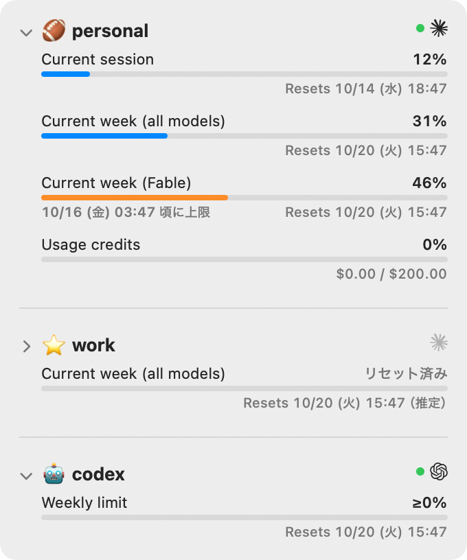
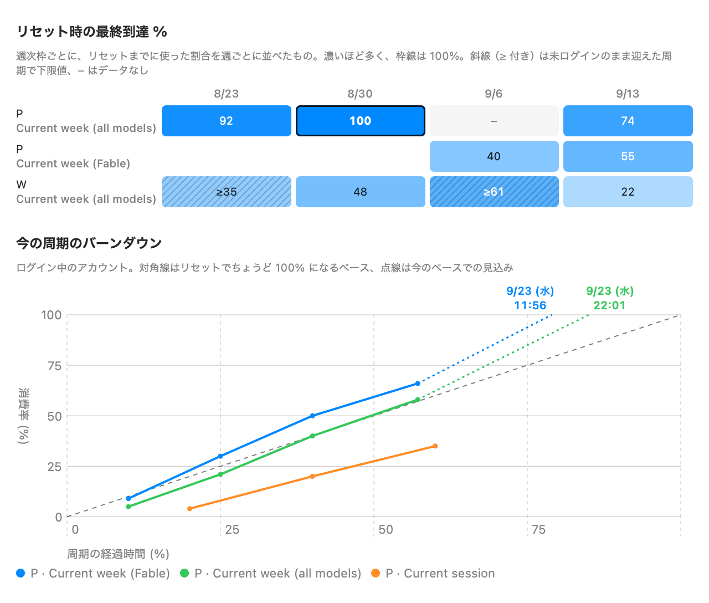

# Quotaback

[English](README.md) | 日本語

Claude Code と Codex の利用上限をどれだけ使ったかを、アカウントごとに macOS のメニューバーに出すアプリです。次にどのアカウントで走らせるかを決めるのに使います。

<p align="center">
  
</p>

## できること

- **全アカウントをひと目で。** メニューバーに各アカウントのいちばん使っている枠の % を出します（例：`🏈 46% · ⭐️ ≥31% · 🤖 0%`）。
- **`/usage` や `/status` と同じ枠。** Claude Code は Current session、Current week（全モデル・モデル別）、Usage credits。Codex は 5h limit と Weekly limit です。
- **上限に届く時刻の見込み。** 今のペースだとリセット前に 100% に届く場合、バーがオレンジになり、届く時刻を出します。
- **ログインしていないアカウントも。** 取得できるのはログイン中のアカウントだけなので、それ以外は最後に観測した値を下限（`≥`）として出します。`/login` で切り替えると数秒で気づきます。
- **分析。** 週ごとのリセット時点でどこまで使ったかと、今の周期の進み具合をグラフで見られます。

## インストール

```sh
brew install --cask otiai10/tap/quotaback
```

[Releases](https://github.com/otiai10/quotaback/releases) から `Quotaback-<version>.zip` をダウンロードし、`Quotaback.app` を `/Applications` に移しても使えます。配布物は署名と公証済みで、macOS 13 以降の Apple シリコン搭載 Mac で動きます。

ソースからビルドする場合（Xcode か Swift 5.9 以降が必要）:

```sh
git clone https://github.com/otiai10/quotaback.git
cd quotaback
make install   # ビルドして ~/Applications に入れる
```

## 使い方

使いたいアカウントで、Claude Code（または Codex）を一度起動してください。ログインしているのを見つけた時点で、そのアカウントが表示されます。

- メニューバーの項目を**クリック**するとパネルが開きます。枠ごとの消費率、リセット時刻、このペースで上限に届く時刻が並びます。ロゴの横の緑の点が、今ログインしているアカウントの印です。
- **右クリック**で「更新」「ログイン時に起動」「終了」を選べます。
- **アカウント右側のプロバイダアイコン**から、Claude Code／Codex CLI の
  ログイン操作を開けます。ホバーすると背景が薄い青になります。
  CLI をバックグラウンドで起動し、ブラウザでログインを開始します。
  ターミナルアプリは不要です。コマンドのコピーも可能です。
  Claude は対象メールを事前入力し、
  Codex はブラウザでアカウントを選択します。

認証中は対象アカウントの行に「ログイン中…」とキャンセル操作を表示します。
通常はブラウザだけで完了し、専用ウィンドウは開きません。
Claude の認可後に CLI 用コードが表示された場合は「ログイン中…」を押して入力できます。
メールログインの6桁コードは元のブラウザタブに入力してください。
手動入力ウィンドウを閉じても認証は続きます。停止するには行のキャンセルを使います。
エラー時だけウィンドウで理由を表示し、5分でタイムアウトします。
ログイン後の緑の点は、既存のアカウント検出結果に従って更新します。
Claude Code／Codex CLI 本体のインストールが必要です。

ログイン操作の対象は通常の CLI 環境です。Desktop アプリの切り替えや、
アカウント別の認証保存先の選択は行いません。処理中の CLI は作業を終えてから
切り替え、再起動後にアカウントを確認してください。


Claude の使用量 API は、手動更新・パネルの開閉・再起動を含め、同じアカウントへは
最短 60 秒間隔で取得します。429 が返った場合は全 Claude アカウントの取得を
5 分休止し、繰り返す場合は最大 30 分まで待機を延ばします。
サーバーが `Retry-After` でさらに長い待機を指定した場合はそれに従います。
待機状態は `usage-throttle.json` に保存するため、再起動後も引き継ぎます。
- パネル下の「**分析**」で、次の2つのグラフのウィンドウが開きます。

<p align="center">
  
</p>

- **リセット時の最終到達 %**：週次の枠ごとに、リセットの時点でどこまで使ったか。斜線のマスは、最後にログインしていなかったので下限です。
- **今の周期のバーンダウン**：ログイン中のアカウントの枠が、周期の中でどう増えているか。対角線は、リセットでちょうど 100% になる均等なペースです。

## 設定

設定は `~/.config/quotaback/config.json` に書きます（パネルの「設定を開く」で開けます）。保存するとすぐに反映されます。

```json
{
  "language": "ja",
  "refreshSeconds": 300,
  "accounts": [
    { "email": "personal@example.com", "provider": "claude", "emoji": "🏈", "label": "個人" },
    { "email": "work@example.com", "provider": "claude", "emoji": "💼", "label": "仕事" },
    { "email": "personal@example.com", "provider": "codex", "emoji": "🤖" }
  ]
}
```

| キー | |
|---|---|
| `language` | `en`（既定）か `ja` |
| `refreshSeconds` | 取得の間隔（秒、既定は 300） |
| `accounts[].email` | アカウント。観測したアカウントはメールアドレスと `provider` で自動的に書き足されます |
| `accounts[].provider` | `claude` か `codex`。保存時は常に明記します。旧設定で省略されている場合は `claude` として読み込みます |
| `accounts[].emoji` | メニューバーとパネルでアカウントの印にする絵文字 |
| `accounts[].label` | パネルに出す名前。無ければメールアドレスの `@` より前を使います。`emoji` が無いとき、メニューバーには `label`、それも無ければメールアドレスの頭文字を出します |

## しくみ

- **Claude Code**：Claude Code が Keychain に置いている OAuth トークン（`Claude Code-credentials`）を読み、`/usage` と同じ API を呼びます。トークンは読むだけで、更新も保存もしません。期限が切れたら、そのアカウントで `claude` を一度起動してください。
- **Codex CLI**：API は呼びません。`~/.codex/sessions` のセッションログから、最新の `rate_limits` を読みます。
- **トークンの持ち主**は、設定ではなく実行時に `~/.claude.json`（`oauthAccount.emailAddress`）や Codex の `auth.json` から判断します。
- **データ**：観測した値は手元の `~/.config/quotaback/` にだけ保存します。下限、リセット時刻の推定、100% に届く時刻は、表示のたびにそこから計算し直します。

> [!WARNING]
> Claude の利用状況の API（`api.anthropic.com/api/oauth/usage`）は公開されていないもので、予告なく変わる可能性があります。

## 開発

```sh
swift run          # ソースから起動
make test          # テスト
make screenshots   # docs/images の画像を合成データから描き直す
```

### リリース

`make release` で `dist/Quotaback-<version>.zip` を作ります。Keychain にある Developer ID Application 証明書で署名し、`quotaback-notary` プロファイル（`xcrun notarytool store-credentials` で作る）で公証して staple したうえで、HEAD にローカルで `v<version>` のタグを打ちます。`VERSION` を指定しなければ、最新のタグの patch を1つ上げます。

`main` を push したあと `make publish` を実行すると、タグを push し、zip を添付した GitHub の Release を作り、[otiai10/homebrew-tap](https://github.com/otiai10/homebrew-tap/blob/main/Casks/quotaback.rb) の `version` と `sha256` を更新します。認証には手元の `git` と `gh` をそのまま使います。済んだ手順は飛ばすので、途中で止まってもやり直せます。
