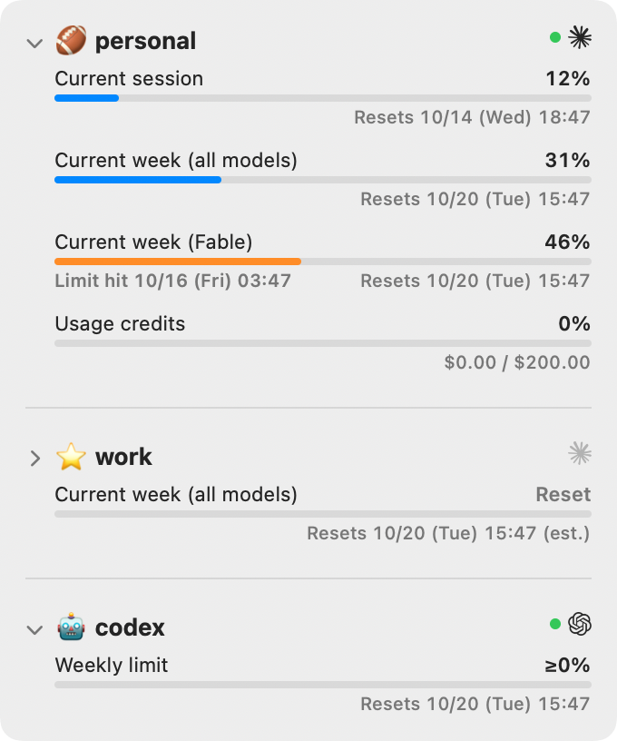
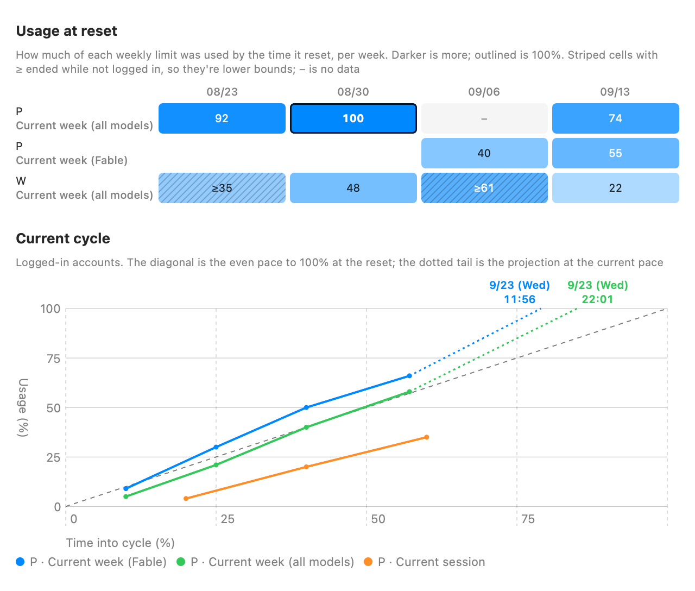

# Quotaback

English | [日本語](README.ja.md)

A macOS menu bar app that shows how much of your Claude Code and Codex usage limits you've used, for each of your accounts, so you can tell which account to run on next.

<p align="center">
  <picture>
    <source media="(prefers-color-scheme: dark)" srcset="docs/images/panel-dark.png">
    
  </picture>
</p>

## Features

- **Every account at a glance.** The menu bar shows the fullest limit of each account, like `🏈 46% · ⭐️ ≥31% · 🤖 0%`.
- **The same limits as `/usage` and `/status`.** Current session, current week (all models and per model) and usage credits for Claude Code; the 5h and weekly limits for Codex.
- **When you'll hit the limit.** At your current pace, the bar turns orange and shows when you'd reach 100% before the reset.
- **Accounts you're not logged in to.** Only the logged-in account can be fetched, so the others keep their last observed value as a lower bound (`≥`). Switching with `/login` is picked up within seconds.
- **Analytics.** How much of each weekly limit you used by each reset, and how the current cycle is going.

## Install

```sh
brew install --cask otiai10/tap/quotaback
```

Or download `Quotaback-<version>.zip` from [Releases](https://github.com/otiai10/quotaback/releases) and move `Quotaback.app` to `/Applications`. Releases are signed and notarized, and need macOS 13 or later on Apple silicon.

To build from source (needs Xcode or the Swift toolchain, 5.9+):

```sh
git clone https://github.com/otiai10/quotaback.git
cd quotaback
make install   # builds and installs to ~/Applications
```

## Usage

Run Claude Code (or Codex) once with each account you want to track. Quotaback starts showing an account as soon as it sees it logged in.

- **Click** the menu bar item for the panel: each limit with its reset time, and when you'd hit it at this pace. A green dot next to the logo marks the account you're logged in to.
- **Right-click** it for Refresh, Launch at Login and Quit.
- **Analytics** at the bottom of the panel opens a window with two charts:

<p align="center">
  <picture>
    <source media="(prefers-color-scheme: dark)" srcset="docs/images/analytics-en-dark.png">
    
  </picture>
</p>

- **Usage at reset**: how much of each weekly limit was used when it reset, by week. Striped cells are lower bounds (the account wasn't logged in at the end).
- **Current cycle**: usage of the logged-in account's limits over the cycle. The diagonal is the even pace to 100% at the reset.

## Configure

Settings live in `~/.config/quotaback/config.json` (**Open Settings** in the panel). Changes apply as soon as you save.

```json
{
  "language": "en",
  "refreshSeconds": 300,
  "accounts": [
    { "email": "personal@example.com", "provider": "claude", "emoji": "🏈", "label": "Personal" },
    { "email": "work@example.com", "provider": "claude", "emoji": "💼", "label": "Work" },
    { "email": "personal@example.com", "provider": "codex", "emoji": "🤖" }
  ]
}
```

| Key | |
|---|---|
| `language` | `en` (default) or `ja` |
| `refreshSeconds` | How often to fetch, in seconds (default 300) |
| `accounts[].email` | 観測したアカウントはメールアドレスと `provider` で自動的に追加されます |
| `accounts[].provider` | `claude` か `codex`。保存時は常に明記します。旧設定での省略は `claude` として読み込みます |
| `accounts[].emoji` | Marks the account in the menu bar and the panel |
| `accounts[].label` | Name in the panel. Without it, the part of the email before `@` is used. Without `emoji`, the menu bar uses `label`, or the first letter of the email |

## How it works

- **Claude Code**: reads the OAuth token Claude Code keeps in the Keychain (`Claude Code-credentials`) and calls the same usage endpoint `/usage` uses. The token is read-only: it is never refreshed or stored. If it has expired, run `claude` with that account once.
- **Codex CLI**: no API calls. Reads the latest `rate_limits` from the Codex session logs under `~/.codex/sessions`.
- **Who owns the token** is decided at runtime from `~/.claude.json` (`oauthAccount.emailAddress`) or Codex's `auth.json`, not from your config.
- **Data**: observations stay on your Mac, in `~/.config/quotaback/`. Estimates (lower bounds, projected resets, time to 100%) are recomputed from them each time.

> [!WARNING]
> The Claude usage endpoint (`api.anthropic.com/api/oauth/usage`) is undocumented and may change without notice.

## Development

```sh
swift run          # run from source
make test          # tests
make screenshots   # re-render the images in docs/images from synthetic data
```

### Releasing

`make release` builds `dist/Quotaback-<version>.zip`: signed with the Developer ID Application identity in your keychain, notarized with the `quotaback-notary` profile (`xcrun notarytool store-credentials`) and stapled. It then tags HEAD `v<version>` locally. Without `VERSION`, it bumps the patch of the latest tag.

Push `main`, then `make publish` pushes the tag, creates the GitHub release with the zip and updates `version` and `sha256` in [otiai10/homebrew-tap](https://github.com/otiai10/homebrew-tap/blob/main/Casks/quotaback.rb), using your own `git` and `gh` credentials. Steps already done are skipped, so it can be re-run.
